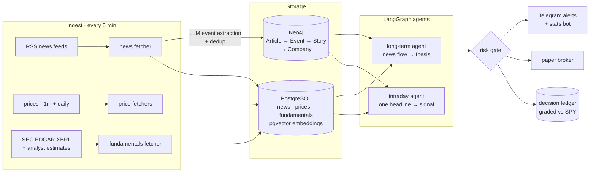
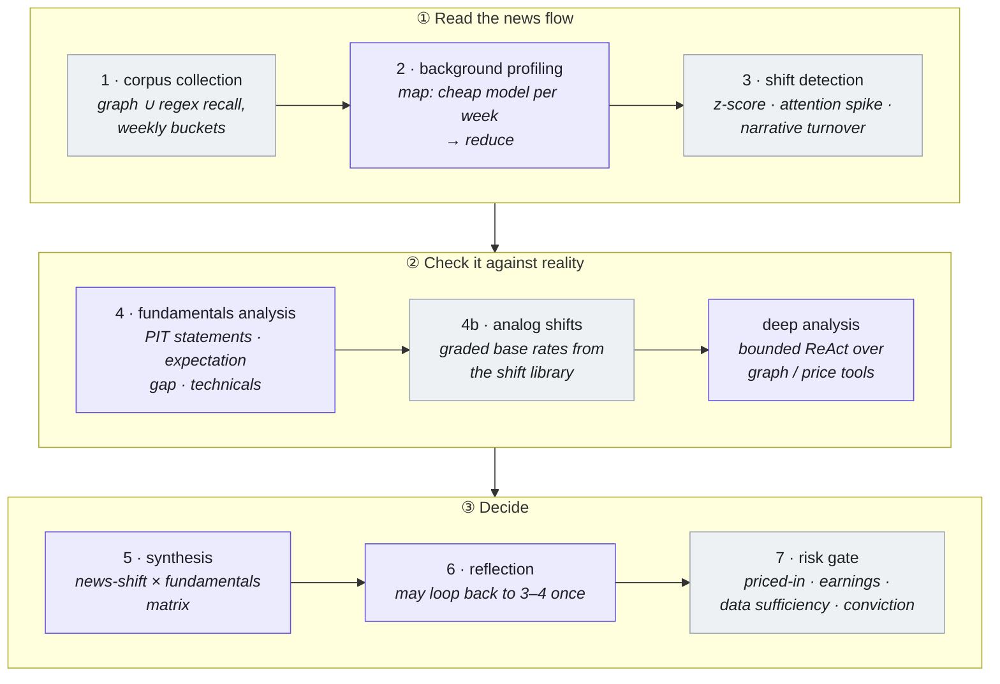
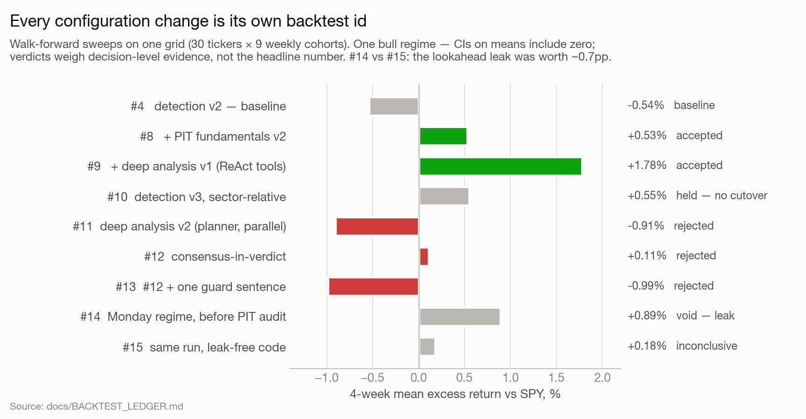
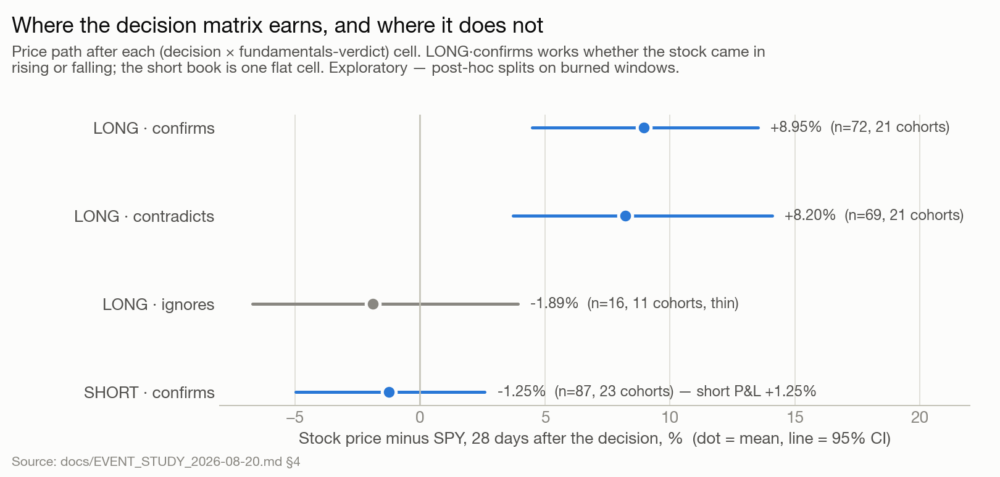
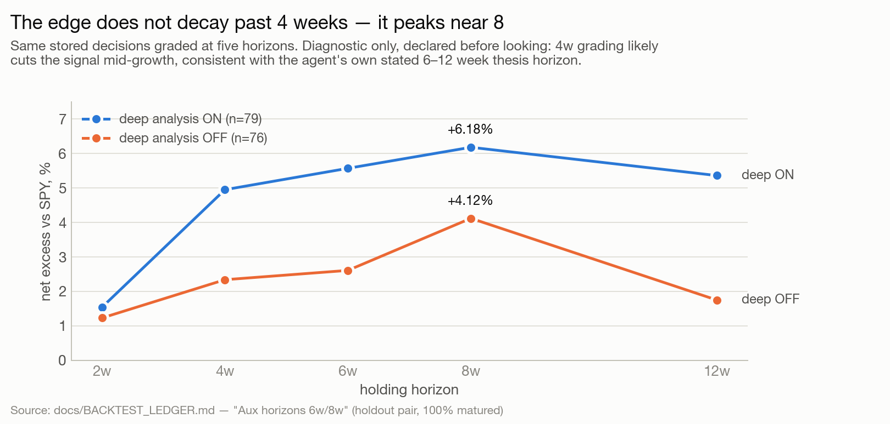
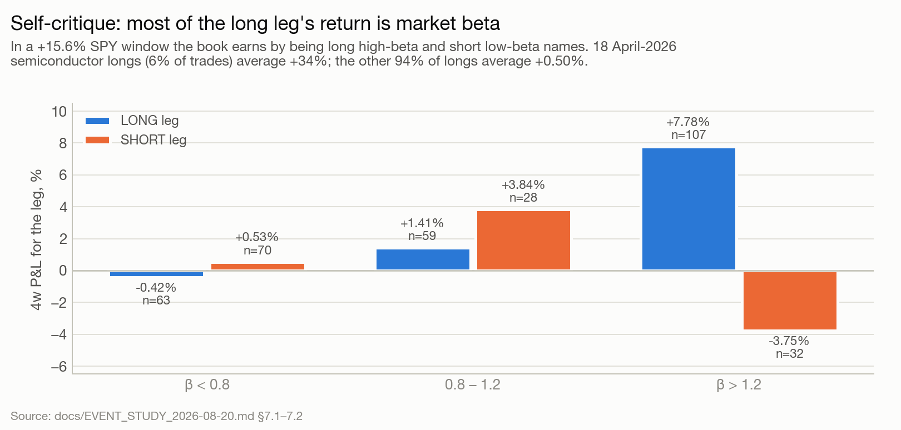
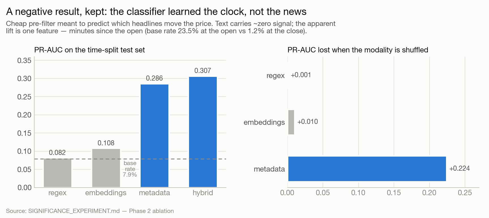

# News Trading Agent

**LLM agents that read a company's news flow, cross-check it against point-in-time
fundamentals, and turn it into a risk-gated trade thesis. The system runs live on a
server and is graded against the market.**

This is a research project, and most of the work went into **measurement**: making a
backtest of an LLM agent trustworthy enough that a result means something. The
architecture is described below, and so is what the experiments found, including the
negative results.

| | |
|---|---|
| **Universe** | 120 US stocks + 12 benchmark ETFs, 1-minute and daily bars |
| **News** | RSS ingest every 5 min, ~36k articles, embedded (pgvector) and extracted into a Neo4j event graph |
| **Agents** | intraday (one headline → signal) and long-term (60–90 days of news → multi-week thesis) |
| **Live** | weekly long-term book since 2026-06-15, graded vs SPY, paper broker (Alpaca), Telegram alerts |
| **Research record** | 15 ledgered walk-forward backtests, pre-registered A/B plans, a full lookahead audit |

---

## Architecture

Everything runs in Docker on a single server. Images are delivered over SSH, never through a
registry ([why](docs/OPERATIONS.md)).

### The long-term agent

The input is a `ticker` and an `as_of` timestamp. The output is LONG, SHORT or NEUTRAL, with a
conviction score, a horizon, a thesis and invalidation conditions.

Grey = deterministic code, violet = LLM. The shift label and the risk gate are rule-based on purpose: the LLM
describes the shift but does not decide whether one happened, so detection labels can be reproduced.

At the core is a 2×2 decision matrix that the synthesis step is constrained to:

| | fundamentals improving | fundamentals deteriorating |
|---|---|---|
| **news shift positive** | high-conviction LONG | hype risk: avoid |
| **news shift negative** | overreaction: contrarian LONG / NEUTRAL | high-conviction SHORT |

Full reference: [`longterm_agent/DECISION_MATRIX.md`](longterm_agent/DECISION_MATRIX.md) ·
schemas: [`longterm_agent/SCHEMAS.md`](longterm_agent/SCHEMAS.md).

---

## Making an LLM backtest trustworthy

An LLM agent will happily score well in a backtest by reading the future. Most of the
engineering exists to stop that, and to stop the research loop from fooling itself.

- **One `as_of` gates every read.** News by `published`, EDGAR statements by original
  filing date, analyst snapshots by fetch date, prices by bar time. Live and backtest are the
  same code path; there is no "backtest mode" that could drift. → [`docs/PIT_RULES.md`](docs/PIT_RULES.md)
- **Tradable fills only.** An entry fills at the first 1-minute bar that starts *strictly
  after* the decision timestamp. The daily conventions either buy 21 hours late or 2.5 hours
  before the decision existed. → [`docs/STRATEGY_MONDAY_MIDDAY.md`](docs/STRATEGY_MONDAY_MIDDAY.md)
- **A content-addressed LLM cache.** Re-running a sweep replays identical completions, so the
  differences between two runs come from the config change and not from sampling noise.
- **A lookahead audit, run against our own code.** On a sample NVDA window it found that half
  the graph events a deep-analysis thread could read had only been reported *later*. Re-running on
  leak-free code cost one result ~0.7pp. → [`docs/PIT_AUDIT_2026-07-19.md`](docs/PIT_AUDIT_2026-07-19.md)
- **Anti-overfit protocol.** Every config change gets its own backtest id. A feature designed
  after looking at a window can be *rejected* on that window but never *accepted* on it. Fixes
  are pre-registered with exactly one formulation, and the number of comparisons per window is
  counted. → [`docs/BACKTEST_LEDGER.md`](docs/BACKTEST_LEDGER.md)
- **A measured noise floor.** Adding one sentence to a prompt reshuffled 9 of ~48 decisions,
  so a headline delta under ±1pp on this grid cannot be told apart from LLM variance. Only
  mechanism-level evidence counts.

---

## Results

> **Read with this caveat:** all data comes from one bull regime (SPY +15.6% over the window,
> deepest 4-week drawdown −2.35%). Confidence intervals on mean excess return include zero
> almost everywhere. These are research findings, not a claim of a profitable strategy.
> Every chart is drawn from numbers recorded in the linked write-up
> ([`docs/figures/make_figures.py`](docs/figures/make_figures.py)).

### 1 · The experiment ledger: what was accepted, and what was not

<picture>
  <source media="(prefers-color-scheme: dark)" srcset="docs/figures/ledger-dark.png">
  
</picture>

Two features made it through: point-in-time fundamentals (#8) and the first version of the
deep-analysis tool node (#9, conviction calibration monotone). The
more elaborate deep-analysis v2 (planner + parallel threads + citations) lost to both and was
rejected. #12 is the interesting rejection: its headline number was flat, but its 4-week conviction
calibration turned monotonic, so the LLM's confidence became usable for sizing (top bucket: 79% win, +4.33%). The
net loss came from a single re-introduced counter-trend short. The fix for that (#13) was
pre-registered, failed, and was parked.

The record also counts against its own wins. #9 ran *before* the lookahead audit, and most of
the leaks the audit found sat in exactly the deep-analysis path, so #9 is an upper bound.
Deep analysis was re-tested on post-audit code on an untouched March 2026 holdout: ON beat OFF
by +2.61pp at 4 weeks, but the CI ([−0.17, +5.59]) covers zero, and ~18 trades carry the gap.
The ledger leaves that unsettled instead of choosing a branch.

### 2 · Where the decision matrix earns

<picture>
  <source media="(prefers-color-scheme: dark)" srcset="docs/figures/matrix_cells-dark.png">
  
</picture>

An event study over 323 detected shifts (2026-04-30 → 08-09, 59 tickers):

- **Bare shift detection does not predict direction.** The pooled signed excess is −0.27%,
  CI [−1.39, +1.49].
- A positive shift is detected *after* the stock has already run (−3.9% vs SPY over the
  preceding 21 days, CI excludes zero). A short entered on a negative shift is late: the stock
  rises over the next 5–10 sessions.
- **The fundamentals verdict is what separates outcomes.** `LONG · confirms` is the one cell
  that works whether the name came in rising or falling. The overreaction cell
  (`LONG · contradicts`) works, but in the wrong half: it was designed for a stock that has
  fallen, and that is exactly where it fails (median −1.88%).

→ [`docs/EVENT_STUDY_2026-08-20.md`](docs/EVENT_STUDY_2026-08-20.md)

### 3 · Holding horizon: the signal is slower than the grading

<picture>
  <source media="(prefers-color-scheme: dark)" srcset="docs/figures/horizon_curve-dark.png">
  
</picture>

The same stored decisions (the March 2026 holdout pair, on post-audit code) were graded at
five horizons. These are the only books where 100% of trades had matured at every horizon. Both arms peak near 8 weeks and roll off by 12, which matches the
agent's own stated "6–12 week" thesis horizon. Grading at 4 weeks cuts the signal mid-growth.
This was declared *diagnostic only* before anyone looked. A horizon change has to be
pre-registered on forward cohorts. The ledger also records the survivor trap: partially matured
12w books looked *better* (+5.0%, +5.8%) only because the earliest cohorts were the best weeks.

### 4 · Self-critique: how much of it is just beta

<picture>
  <source media="(prefers-color-scheme: dark)" srcset="docs/figures/beta-dark.png">
  
</picture>

In a rising market a book that is long high-beta names and short low-beta names makes money
without selecting anything. Splitting by beta shows that this is most of the long leg. On top of
that, 18 April-2026 semiconductor longs (INTC, AMD, MU) carry its mean. The long leg's *median*
is negative at every horizon, while the short leg's median is positive at every horizon: the
short side is the reliable one and the long side behaves like a lottery ticket. Both
statements are in the write-up so that neither gets quoted alone.

### 5 · A negative result, kept on purpose

<picture>
  <source media="(prefers-color-scheme: dark)" srcset="docs/figures/significance-dark.png">
  
</picture>

A cheap regex + embedding classifier was meant to filter headlines before the expensive agent
saw them, with "significant" defined as "moved the price ≥2σ within 30 minutes". The hybrid
model beat the baseline about 4×, and the ablation showed why: shuffling the text features
costs nothing, while one metadata feature, *minutes since the open*, carries the whole result.
The label was confounded by the intraday volatility curve (23.5% base rate at the open vs 1.2% at
the close). The model had learned the clock, not the news. → [`SIGNIFICANCE_EXPERIMENT.md`](SIGNIFICANCE_EXPERIMENT.md)

### Smaller findings worth knowing

- **The latency is in the feed, not in the agent.** The agent's thinking time has a median of
  60s, but RSS polling shows a story a median of **9.8 minutes** after publication. On the
  intraday sample, timing entries from the moment the story is first seen instead of its
  publication time cut the 30-minute mean from +0.073% to +0.004%. A faster model cannot win
  that back. → [`docs/PREREG_HOLDING_CURVE_2026-07-28.md`](docs/PREREG_HOLDING_CURVE_2026-07-28.md)
- **The fundamentals verdict is not config-stable.** 11% of (ticker, date) pairs get a different
  verdict under different sweep configs. That is now a reported metric in every A/B plan.
- **Live book, honestly.** 341 live runs over 9 weeks traded 34 times (10%), with zero synthesis
  failures. 2-week book: +0.88% mean (n=18). Only 7 trades had matured at 4 weeks, so the live
  data cannot distinguish anything yet; the write-up says so, rather than quoting the better
  horizon.

---

## Repository map

| Path | What lives there |
|---|---|
| [`longterm_agent/`](longterm_agent/) | the long-term agent: LangGraph pipeline, tools, walk-forward harness, grading, scheduler, broker, stats bot |
| [`news_agent/`](news_agent/) | the intraday agent: one headline → ticker extraction → sentiment, technicals, analogs → signal |
| [`graph_db/`](graph_db/) | Neo4j layer: LLM event extraction, event/story dedup, graph query tools |
| [`bloomberg_news_fetcher/`](bloomberg_news_fetcher/) | news, price, EDGAR and fundamentals fetchers, DB schemas |
| [`core/`](core/) | shared settings, LLM and embedding clients |
| [`evals/`](evals/) | node-level evals on frozen inputs |
| [`significance/`](significance/) | the significance-classifier experiment |
| [`profit_compute/`](profit_compute/) | intraday trade simulation and confidence calibration |
| [`docs/`](docs/) | backtest ledger, pre-registrations, audits, event study, DB docs |

**Key documents:** [backtest ledger](docs/BACKTEST_LEDGER.md) ·
[PIT rules](docs/PIT_RULES.md) · [benchmark convention](docs/BENCHMARK_CONVENTION.md) ·
[walk-forward protocol](longterm_agent/WALK_FORWARD_PROTOCOL.md) ·
[long-term agent](longterm_agent/README.md) · [Postgres](docs/DATABASE_POSTGRES.md) /
[Neo4j](docs/DATABASE_NEO4J.md) schemas

## Running it

This repository documents a research system rather than shipping a product. It needs its own
Postgres + Neo4j, a populated news history and API keys. The runbook is in
**[`docs/OPERATIONS.md`](docs/OPERATIONS.md)**, and agent-level commands are in
[`longterm_agent/README.md`](longterm_agent/README.md#4-running). Configuration starts from
[`.env.example`](.env.example).

## Stack

Python · LangGraph / LangChain · LangSmith tracing · OpenRouter-hosted LLMs (a main reasoning
model + a cheap map model) · PostgreSQL + pgvector · Neo4j · pandas / NumPy / scikit-learn ·
pytest (600+ tests) · Docker · Alpaca paper trading · Telegram Bot API
