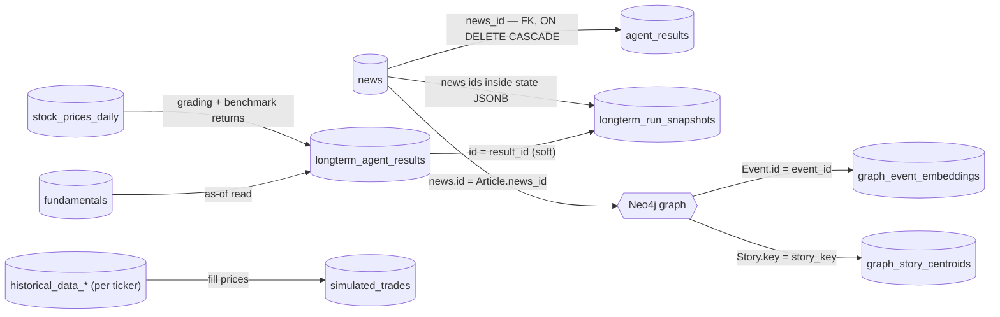

# PostgreSQL Schema — `trade_agent`

Reference for every table in the `public` schema: columns, keys, indexes, who writes it,
who reads it, and the invariants that are not obvious from the DDL.

Companion document: [DATABASE_NEO4J.md](DATABASE_NEO4J.md) (event/story graph).
Pipeline narrative for the graph layer: [../graph_db/GRAPH_DB.md](../graph_db/GRAPH_DB.md).

**Live snapshot taken 2026-08-02** — row counts and date ranges below are from the running
database and are illustrative of scale, not part of the contract.

| | |
|---|---|
| Database | `trade_agent` |
| Server | PostgreSQL 18.2 (Debian, x86_64) |
| Extensions | `plpgsql` 1.0, `vector` (pgvector) 0.8.1 |
| Tables | 141 (20 core + 121 per-ticker `historical_data_*`) |
| Total size | ~2.0 GB (`historical_data_*` ≈ 947 MB, `news` ≈ 752 MB) |

---

## Connection

Environment variables (see `.env.example`):

| Variable | Meaning |
|---|---|
| `DB_HOST` | server IP |
| `DB_NAME` | `trade_agent` |
| `DB_USER` / `DB_PASSWORD` | credentials |
| `DB_PORT` | `5432` inside Docker, **`5544`** from outside the server (the default port is ISP-blocked) |

```bash
psql -h "$DB_HOST" -p "$DB_PORT" -U "$DB_USER" -d trade_agent
```

---

## Conventions that apply across the schema

**Timezone.** Everything is stored in **US Eastern (`America/New_York`)** as naive
`TIMESTAMP` — RSS dates are assumed UTC and converted on ingest. The single exception is
`news_parser_log.log_time`, which is UTC. `TIMESTAMPTZ` columns (`run_timestamp`,
`created_at` on newer tables) store real UTC instants and are rendered per session TZ.

**Versioning.** Result tables carry `agent_version` / `detection_version` and make it part
of the uniqueness key. A logic change means a new version writing new rows next to the old
ones; nothing is overwritten, and comparison queries filter by version. Never compare rows
across versions without an explicit version filter — fingerprints are not commensurable.

**Point-in-time (PIT).** Tables that feed backtests carry an as-of gate column
(`filed_date`, `fetch_date`, `as_of`, `published`). Readers must filter `<= as_of` so a run
can never see data that did not exist yet. See [PIT_RULES.md](PIT_RULES.md).

**JSONB payloads.** Reasoning artifacts, provenance, and raw vendor responses are stored as
`JSONB` rather than exploded into columns — the metric definitions evolve in the agent's
read side without a re-backfill.

**NaN is not NULL.** `NaN` is a *valid* `numeric` value in Postgres: it passes `NOT NULL`
and every `IS NOT NULL` filter, then detonates far downstream at an `int()`/`round()` or a
JSONB write. `stock_prices_daily` carries a `CHECK` constraint rejecting it at the storage
layer; result tables carry `finite_numbers` checks on their return columns. `NULL` remains
legal — "no close for this bar" is a readable state, `NaN` is not.

**DDL location.** Tables are created either by a checked-in `.sql` script or by an
idempotent `CREATE TABLE IF NOT EXISTS` embedded in the module that owns the table. Columns
added after the fact use `ALTER TABLE … ADD COLUMN IF NOT EXISTS` at job startup, so the
`.sql` files are a floor, not the full picture — the per-table sections below list the live
column set.

---

## Table map

Only one real foreign key exists (`agent_results.news_id → news.id`). Every other link below
is a *soft* reference maintained by application code — including the two that cross into
Neo4j.



Groups:

| Group | Tables |
|---|---|
| News ingestion | [`news`](#news), [`news_parser_log`](#news_parser_log) |
| Market data | [`stock_prices_daily`](#stock_prices_daily), [`historical_data_<ticker>`](#historical_data_ticker), [`stock_prices`](#stock_prices-legacy), [`macro_series`](#macro_series), [`options_iv`](#options_iv) |
| Fundamentals & filings | [`fundamentals`](#fundamentals), [`filings`](#filings), [`insider_trades`](#insider_trades) |
| Graph support (pgvector) | [`graph_event_embeddings`](#graph_event_embeddings), [`graph_story_centroids`](#graph_story_centroids) |
| Agent output | [`agent_results`](#agent_results), [`longterm_agent_results`](#longterm_agent_results), [`longterm_run_snapshots`](#longterm_run_snapshots), [`shift_library`](#shift_library), [`backtest_runs`](#backtest_runs), [`simulated_trades`](#simulated_trades) |
| Caches | [`bucket_summary_cache`](#bucket_summary_cache), [`longterm_llm_cache`](#longterm_llm_cache) |
| Ops | [`longterm_agent_log`](#longterm_agent_log) |

---

# News ingestion

## `news`

Every article fetched from the RSS sources, with a pgvector embedding of title+summary.
This is the root table — `agent_results` FKs into it, and the Neo4j `Article` node stores
`news.id` as its only property.

DDL: [`bloomberg_news_fetcher/create_table.sql`](../bloomberg_news_fetcher/create_table.sql) ·
Writer: `bloomberg_news_fetcher/news_fetcher.py`

| Column | Type | Null | Notes |
|---|---|---|---|
| `id` | `serial` | no | `UNIQUE` — the join key used everywhere else (incl. Neo4j `Article.news_id`) |
| `link` | `text` | no | **PRIMARY KEY** — the article URL, so re-fetching the same URL is a no-op |
| `source` | `varchar(50)` | yes | feed slug, e.g. `bloomberg-markets`, `cnbc-top`, `marketwatch-top` |
| `published` | `timestamp` | yes | publication time from the feed, converted to ET. **The PIT clock** for news |
| `fetch_time` | `timestamp` | yes | when we pulled it, ET |
| `title` | `text` | yes | |
| `summary` | `text` | yes | feed summary |
| `full_text` | `text` | yes | scraped body when available |
| `embedding` | `vector(1536)` | yes | `gemini-embedding-001` over title+summary, via OpenRouter |
| `created_at` | `timestamp` | yes | row insert time, `CURRENT_TIMESTAMP` |

Indexes: `idx_news_published (published DESC)`, `idx_news_fetch_time (fetch_time DESC)`,
`idx_news_source (source)`, `idx_news_embedding` — **HNSW** `vector_cosine_ops`.

> `PRIMARY KEY (link)` + `UNIQUE (id)` is deliberate: dedup is by URL, joins are by integer.

Live: 37,240 rows · 752 MB · `published` 2024-12-11 → 2026-08-02 · 33,819 embedded ·
top sources `bloomberg-markets` 14,612, `bloomberg-technology` 6,238,
`bloomberg-industries` 5,074, `bloomberg-economics` 3,591, `cnbc-top` 3,418,
`marketwatch-top` 3,078.

Typical read — semantic search with a PIT gate:

```sql
SELECT id, title, published, 1 - (embedding <=> %(vec)s) AS score
FROM news
WHERE published <= %(as_of)s AND embedding IS NOT NULL
ORDER BY embedding <=> %(vec)s
LIMIT 20;
```

## `news_parser_log`

Fetcher-level operational log. **`log_time` is UTC**, unlike every other timestamp in this
database.

DDL: [`bloomberg_news_fetcher/create_log_table.sql`](../bloomberg_news_fetcher/create_log_table.sql)

| Column | Type | Notes |
|---|---|---|
| `id` | `serial` | PK |
| `log_time` | `timestamp` | **UTC** |
| `log_level` | `varchar(20)` | `INFO` / `WARNING` / `ERROR` |
| `event_type` | `varchar(50)` | `FETCH_START`, `FETCH_COMPLETE`, `DB_SAVE`, `DB_SKIP`, `EMBEDDING_FAIL`, `PRICE_FETCH_*`, … |
| `message` | `text` | |
| `article_link` | `text` | when the event concerns one article |
| `details` | `jsonb` | free-form payload |

Indexes on `log_time DESC`, `log_level`, `event_type`.

Live: 5,080 rows — dominated by `DB_SKIP` (3,947 = already-seen URLs).

---

# Market data

## `stock_prices_daily`

Daily OHLCV bars from yfinance. One table for all tickers (daily data is small), unlike the
per-ticker minute tables. This is the backbone for 180-day technicals (50/200 MA),
priced-in checks, benchmark returns, and every multi-week backtest.

DDL: [`bloomberg_news_fetcher/create_daily_price_table.sql`](../bloomberg_news_fetcher/create_daily_price_table.sql) ·
Writer: `bloomberg_news_fetcher/daily_price_fetcher.py`

| Column | Type | Null | Notes |
|---|---|---|---|
| `id` | `serial` | no | PK |
| `ticker` | `varchar(10)` | no | |
| `date` | `date` | no | |
| `open` `high` `low` `close` `adj_close` | `numeric(14,4)` | yes | |
| `volume` | `bigint` | yes | |
| `fetch_time` | `timestamp` | yes | |

Keys: `UNIQUE (ticker, date)` — the `ON CONFLICT` target for idempotent re-fetch.
Indexes: `idx_spd_ticker (ticker, date DESC)`, `idx_spd_date (date DESC)`.

**`CHECK stock_prices_daily_no_nan`** rejects `NaN` in all five price columns. This is not
belt-and-braces: on 2026-07-24 yfinance returned `Close=NaN` for 131 tickers, the fetcher
stored it verbatim, and the Sunday batch lost 49 of 64 tickers plus every decision it had
made. The writer now drops non-finite bars — the constraint is the guarantee that does not
depend on any future writer remembering to.

Live: 70,003 rows · 132 tickers · 2024-06-17 → 2026-07-31.

## `historical_data_<ticker>`

1-minute intraday bars, **one table per ticker**. Name: `historical_data_` + lowercased
ticker with `-` and `.` replaced by `_` (`BRK-B` → `historical_data_brk_b`). Created on
demand by `create_ticker_table()`.

DDL: [`bloomberg_news_fetcher/price_fetcher.py:124`](../bloomberg_news_fetcher/price_fetcher.py#L124)

| Column | Type | Null | Notes |
|---|---|---|---|
| `id` | `serial` | no | PK |
| `timestamp` | `timestamp` | no | **`UNIQUE`** — ET, minute-aligned; the btree behind this constraint serves all range/ORDER BY reads |
| `open` `high` `low` `close` | `numeric(12,4)` | yes | |
| `volume` | `bigint` | yes | |
| `fetch_time` | `timestamp` | yes | insert-only |

> The comment in `price_fetcher.py` says no extra indexes are created, because the
> `UNIQUE(timestamp)` btree already covers the access pattern. Tables created before that
> change still carry `idx_historical_data_<t>_timestamp` and `..._fetch_time`; they are
> redundant but harmless.

**Yahoo's two hard limits** (probed against the live API 2026-07-29, not read from docs):
8 days of 1-minute data per request (we chunk at 7), and the requested range must fall
within the last 30 days. The second is why a coverage hole older than 30 days **can never
be repaired from this source** — the window is forward-only.

Live: 121 tables · ~947 MB total · e.g. `historical_data_aapl` = 42,304 bars,
2026-02-23 → 2026-07-31.

Tickers with a table: AAPL, ABBV, ABNB, ABT, ACN, ADBE, ADP, ADSK, AEP, AMAT, AMD, AMGN,
AMT, AMZN, APD, AVGO, AXP, BA, BAC, BKNG, BLK, BMY, BRK_B, C, CAT, CB, CCI, CDNS, CHTR, CI,
CMCSA, CMG, COP, COST, CRM, CSCO, CVS, CVX, DE, DHR, DIS, DUK, ECL, EL, EOG, EQIX, FTNT,
GE, GILD, GOOG, GOOGL, GS, HD, HON, HUM, IBM, INTC, INTU, ISRG, JNJ, JPM, KO, LIN, LLY,
LMT, LOW, LRCX, MA, MCD, MDT, META, MMM, MPC, MRK, MS, MSFT, MU, NEE, NEM, NFLX, NKE, NOC,
NOW, NVDA, ORCL, PANW, PEP, PFE, PG, PLD, PSA, PSX, PYPL, QCOM, REGN, RTX, SBUX, SHW, SLB,
SNPS, SO, SPGI, SQ, T, TGT, TJX, TMO, TMUS, TSLA, TXN, UBER, UNH, UNP, UPS, V, VRTX, VZ,
WFC, WMT, XOM, XYZ.

## `stock_prices` (legacy)

The original single-table design for 1-minute bars, superseded by the per-ticker tables.
Same columns plus `ticker`, `UNIQUE (ticker, timestamp)`, four indexes.

DDL: [`bloomberg_news_fetcher/create_price_table.sql`](../bloomberg_news_fetcher/create_price_table.sql)

Live: **0 rows.** Nothing writes it. Kept for reference; the intraday reader path is
`historical_data_<ticker>`.

## `macro_series`

Long-history macro and volatility series (FRED + yfinance), tall format. Backfilled from
2010-01-01 so percentile windows have ≥5y of history before the first stamp; each run
re-scans a trailing 21 days to heal FRED's publication lag and weekly series.

DDL: [`bloomberg_news_fetcher/macro_fetcher.py:62`](../bloomberg_news_fetcher/macro_fetcher.py#L62)

| Column | Type | Notes |
|---|---|---|
| `series` | `varchar(24)` | PK part |
| `date` | `date` | PK part |
| `value` | `double precision` | `NOT NULL` |
| `fetched_at` | `timestamp` | |

`PRIMARY KEY (series, date)` · index on `date`.

Live series: `vix` (9,213 rows, from 1990-01-02), `wti` (6,514, from 2000-08-23),
`vix3m` (5,042), `brent` (4,732), `dgs10` (4,146), `rrp` (3,221), `fed_bs` (865),
`tga` (865), `hy_oas` (802). All current through 2026-07-29/31.

## `options_iv`

One compact implied-volatility snapshot per ticker per day: ATM call/put IV, ±10% skew
points, put/call open interest, across the nearest 3 expiries. The chain itself is not
stored — `data` holds the summary produced by `summarize_chain()`.

DDL: [`bloomberg_news_fetcher/options_fetcher.py:32`](../bloomberg_news_fetcher/options_fetcher.py#L32)

| Column | Type | Notes |
|---|---|---|
| `ticker` | `varchar(10)` | PK part |
| `snapshot_date` | `date` | PK part |
| `data` | `jsonb` | `{expiry, atm_call_iv, atm_put_iv, call_iv_p110, put_iv_p90, put_skew, call_oi, put_oi, put_call_oi}` per expiry |
| `fetched_at` | `timestamp` | |

Live: 1,908 rows · 120 tickers · 2026-07-15 → 2026-08-01. (Snapshot-only — there is no
history before the fetcher was deployed, and none can be reconstructed.)

---

# Fundamentals & filings

## `fundamentals`

Two sources share this table, and the difference matters for PIT:

* **`edgar`** — historical as-filed statements. True point-in-time via the 10-Q/10-K
  `filed_date`. Backfilled once, then topped up.
* **`yfinance`** — current snapshots (valuation ratios, margins, analyst estimates, earnings
  dates) captured weekly. Each snapshot is keyed by `fetch_date`, which builds a *forward*
  PIT archive: rows only become available going forward, not retroactively.

DDL: [`bloomberg_news_fetcher/create_fundamentals_table.sql`](../bloomberg_news_fetcher/create_fundamentals_table.sql)

| Column | Type | Null | Notes |
|---|---|---|---|
| `id` | `serial` | no | PK |
| `ticker` | `varchar(10)` | no | |
| `source` | `varchar(20)` | no | `edgar` · `yfinance` · `fmp` |
| `kind` | `varchar(40)` | no | edgar: `income_statement`/`balance_sheet`/`cash_flow`; yfinance: `info`/`earnings_dates`/`analyst_estimates`/`eps_revisions`; fmp: `earnings` |
| `period_end` | `date` | yes | statement period end (NULL for snapshots) |
| `fiscal_period` | `varchar(10)` | yes | `Q1`…`Q4` / `FY` (NULL for snapshots) |
| `filed_date` | `date` | yes | **EDGAR PIT key** |
| `fetch_date` | `date` | no | **yfinance PIT key** |
| `dedup_key` | `text` | no | `UNIQUE`; computed in Python as `ticker\|source\|kind\|period_end\|fiscal_period\|filed_date\|fetch_date` |
| `data` | `jsonb` | no | normalized payload; derived metrics computed at read time |
| `created_at` | `timestamp` | yes | |

Indexes: `idx_fundamentals_ticker`, `..._lookup (ticker, kind, period_end DESC)`,
`..._filed (ticker, filed_date DESC)`, `..._fetch (ticker, kind, fetch_date DESC)`.

> `dedup_key` exists because NULLs in a multi-column `UNIQUE` are treated as distinct across
> Postgres versions — a text key gives a version-independent `ON CONFLICT` target.

The as-of read is source-dependent:

```sql
-- EDGAR: never see a statement before it was filed
SELECT * FROM fundamentals
WHERE ticker=%s AND source='edgar' AND filed_date <= %(as_of)s
ORDER BY period_end DESC;

-- yfinance: use the snapshot that was known at the time
SELECT * FROM fundamentals
WHERE ticker=%s AND source='yfinance' AND kind='info' AND fetch_date <= %(as_of)s
ORDER BY fetch_date DESC LIMIT 1;
```

Live: 12,547 rows — edgar `income_statement` 3,626 / `balance_sheet` 3,398 /
`cash_flow` 2,228; yfinance `eps_revisions` 981 / `analyst_estimates` 973 / `info` 972 /
`earnings_dates` 260; fmp `earnings` 159.

## `filings`

Full text of 8-K and offering filings pulled from SEC EDGAR. Body and exhibits are stripped
to text and capped at 150,000 chars per document.

DDL: [`bloomberg_news_fetcher/filings_fetcher.py:46`](../bloomberg_news_fetcher/filings_fetcher.py#L46)

| Column | Type | Notes |
|---|---|---|
| `id` | `serial` | PK |
| `ticker` | `varchar(10)` | `NOT NULL` |
| `cik` | `bigint` | |
| `form` | `varchar(12)` | tracked: `8-K`, `8-K/A`, `S-1`, `S-3`, `424B5` |
| `filed_date` | `date` | `NOT NULL` — PIT key |
| `accession` | `varchar(25)` | **`UNIQUE`** |
| `items` | `text` | 8-K item codes |
| `primary_doc`, `url` | `text` | |
| `body_text`, `exhibit_text` | `text` | stripped text, ≤150k chars each |
| `fetched_at` | `timestamp` | |

Index: `filings_tkr_date_idx (ticker, filed_date)`.

Live: 1,718 rows · 21 MB · `8-K` 1,594, `424B5` 138, `8-K/A` 30, `S-3` 5.

## `insider_trades`

Form 4 transactions, one row per transaction line.

DDL: [`bloomberg_news_fetcher/filings_fetcher.py:63`](../bloomberg_news_fetcher/filings_fetcher.py#L63)

| Column | Type | Notes |
|---|---|---|
| `id` | `serial` | PK |
| `ticker` | `varchar(10)` | `NOT NULL` |
| `accession` + `seq` | `varchar(25)` + `integer` | **`UNIQUE (accession, seq)`** — `seq` is the line index within the filing |
| `filed_date` | `date` | `NOT NULL` — PIT key (a trade is only knowable once filed) |
| `transaction_date` | `date` | when the trade happened |
| `insider_name`, `insider_title` | `text` | |
| `code` | `varchar(2)` | Form 4 transaction code (`P` purchase, `S` sale, `A` award, …) |
| `acquired` | `boolean` | |
| `shares`, `price`, `value` | `double precision` | |
| `raw` | `jsonb` | full parsed line |
| `fetched_at` | `timestamp` | |

Index: `insider_tkr_date_idx (ticker, filed_date)`.

Live: 19,751 rows · 118 tickers · 2025-07-15 → 2026-07-31.

---

# Graph support (pgvector)

These two tables are the vector-search half of the Neo4j graph: Neo4j holds structure and
properties, Postgres holds the embeddings, because pgvector's ANN search is what makes
event/story resolution cheap. See [DATABASE_NEO4J.md](DATABASE_NEO4J.md).

## `graph_event_embeddings`

DDL: [`graph_db/event_updater.py:128`](../graph_db/event_updater.py#L128) (also created by
`bloomberg_news_fetcher/auto_news_fetcher.py` on startup)

| Column | Type | Notes |
|---|---|---|
| `event_id` | `text` | PK — **equals Neo4j `Event.id`** (UUID) |
| `embedding` | `vector(1536)` | event name+description embedding |
| `event_date` | `date` | the article's `published`, used for the ±21-day dedup window |

Index: `gee_date_idx (event_date)`.

Live: 11,469 rows · 93 MB · `event_date` 2025-10-17 → 2026-08-02.

> No FK to Neo4j is possible; consistency is maintained by the writer. Rows can be pruned by
> `EVENT_EMBEDDING_RETENTION_DAYS` without touching the graph.

## `graph_story_centroids`

DDL: [`graph_db/event_updater.py:136`](../graph_db/event_updater.py#L136)

| Column | Type | Notes |
|---|---|---|
| `story_key` | `text` | PK — **equals Neo4j `Story.key`** |
| `centroid` | `vector(1536)` | L2-normalized running mean of member event embeddings |
| `event_count` | `integer` | members folded into the centroid, default 1 |
| `last_updated` | `timestamp` | |
| `start_date` | `timestamptz` | story birth date; drives the event-type-specific temporal window |
| `status` | `text` | `active` / `closed` / `merged`, default `active` |

Indexes: `gsc_status_idx (status)`, `gsc_start_date_idx (start_date)`.

Centroid update on each merge: `centroid = L2_normalize((old * N + new) / (N + 1))`.
`status` mirrors `Story.status` in Neo4j and is kept in sync by `close_stale_stories()` and
`merge_duplicate_stories()`; candidate search filters `WHERE status = 'active'`.

Live: 5,726 rows · 52 MB — `closed` 4,261, `active` 1,386, `merged` 89.

---

# Agent output

## `agent_results`

Results of the short-horizon news agent (`simple_agent` / `complex_agent`), one row per
analyzed article.

DDL: [`batch_analysis/create_agent_results_table.sql`](../batch_analysis/create_agent_results_table.sql)

| Column | Type | Notes |
|---|---|---|
| `id` | `serial` | PK |
| `run_timestamp` | `timestamptz` | `now()` |
| `agent_name` | `varchar(50)` | `NOT NULL` |
| `agent_version` | `varchar(20)` | `NOT NULL` |
| `news_id` | `integer` | **`FK → news(id) ON DELETE CASCADE`** — the only real FK in the schema |
| `news_title` | `text` | denormalized for convenience |
| `news_published` | `timestamptz` | |
| `signals_generated` | `integer` | default 0 |
| `signals_json` | `jsonb` | full signal array |
| `execution_time_seconds` | `double precision` | |
| `news_type` | `varchar(50)` | optional category |

Indexes: `run_timestamp`, `agent_name`, `news_id`, `news_published`.

Live: 11,234 rows — `complex_agent` `0.1.0` 10,139, `2.0.0` 2,000, then 100–500 rows each
for `2.1`–`2.4`.

## `longterm_agent_results`

The live long-term (multi-week) agent. One row per `(agent_version, ticker, as_of)`, holding
the full reasoning chain as JSONB plus the final signal, so every run is auditable and the
grading job can attach realized outcomes weeks later.

DDL: [`longterm_agent/create_results_table.sql`](../longterm_agent/create_results_table.sql) ·
columns extended at runtime by [`persistence.py`](../longterm_agent/persistence.py#L66) and
[`grade_results.py`](../longterm_agent/grade_results.py#L41)

**Identity**

| Column | Type | Notes |
|---|---|---|
| `id` | `serial` | PK |
| `agent_name` | `varchar(50)` | default `'longterm_agent'` |
| `agent_version` | `varchar(20)` | `NOT NULL` |
| `run_timestamp` | `timestamptz` | `now()` |
| `ticker` | `varchar(10)` | `NOT NULL` |
| `as_of` | `date` | `NOT NULL` — the analysis date; the run saw only data ≤ this |
| `lookback_days` | `integer` | |

`UNIQUE (agent_version, ticker, as_of)` — re-running the same version is idempotent.

**Reasoning artifacts** (one JSONB per pipeline stage)

| Column | Stage |
|---|---|
| `background_profile` | news background profiling |
| `background_shift` | shift detection/characterization |
| `fundamentals_summary` | fundamentals node |
| `shift_analogs` | analogical reasoning over `shift_library` |
| `enriched_analysis` | deep analysis (Phase 7A): findings + advisory conviction adjustment |
| `signal` | final `LongTermSignal` — direction, conviction, horizon, thesis, invalidation |

**Decision**

| Column | Type | Notes |
|---|---|---|
| `verdict` | `varchar(20)` | `LONG` / `SHORT` / `NEUTRAL` / `NO_DATA` — the **raw** direction |
| `traded` | `boolean` | directional **and** passed the risk gate → actionable. Default `false` |
| `risk_flags` | `jsonb` | why the gate filtered or flagged it |
| `risk_checks` | `jsonb` | individual gate checks incl. the regime-context stamp |
| `gate_trace` | `jsonb` | gate decision trace |
| `conviction` | `real` | |
| `article_count` | `integer` | corpus size |
| `execution_time_seconds` | `double precision` | |

> `verdict` is the model's opinion; `traded` is what the system would actually act on.
> Performance queries almost always want `WHERE traded`.

**Entry / fill**

| Column | Type | Notes |
|---|---|---|
| `entry_date` | `date` | |
| `entry_px` | `real` | |
| `fill_convention` | `varchar(12)` | e.g. `open_t1`, `mid_1m` — which fill rule produced `entry_px` |

**Realized outcome** (backfilled by the grading job once each horizon matures)

| Column | Type | Notes |
|---|---|---|
| `fwd_return_2w` / `_4w` / `_12w` | `real` | stock return per horizon |
| `benchmark_return_2w` / `_4w` / `_12w` | `real` | SPY over the same window |
| `sector_benchmark` | `varchar(8)` | sector ETF used |
| `sector_benchmark_return_4w` | `real` | |
| `beta`, `excess_beta` | `real` | beta and beta-adjusted excess |
| `fwd_return_stopped`, `benchmark_return_stopped` | `real` | with exit rules applied |
| `exit_reason` | `varchar(12)` | which exit rule fired |
| `exit_days` | `integer` | days held to exit |
| `exit_alert_at` | `date` | |
| `worst_position_return_4w` | `real` | max adverse excursion — grades risk sizing / exit discipline |
| `aux_targets` | `jsonb` | per-node outcome targets (realized fundamentals verdict, shift persistence) |
| `outcome_filled_at` | `date` | NULL = not yet graded |

Indexes: `idx_lar_ticker (ticker, as_of DESC)`, `idx_lar_version`, `idx_lar_verdict`,
`idx_lar_traded`. `CHECK longterm_agent_results_finite_numbers` on the return columns.

Live: 144 rows — version `0.2.0` 130 rows (2026-06-19 → 2026-07-26), `0.1.0` 19 rows.
Verdicts: NEUTRAL 119, LONG 14, SHORT 6, NO_DATA 10.

## `longterm_run_snapshots`

A replayable full-state snapshot per run — **the future training set** for the
prompt-tuning / fine-tuning loop. Deterministic inputs go in by reference (corpus as
`news` ids; fundamentals reproducible from `(ticker, as_of)` + `provenance.git_revision`);
LLM outputs go in **in full**, because outcomes can only be joined later if the exact
inputs and outputs were captured now.

DDL: [`longterm_agent/snapshots.py:20`](../longterm_agent/snapshots.py#L20)

| Column | Type | Notes |
|---|---|---|
| `id` | `serial` | PK |
| `result_id` | `integer` | **soft** ref → `longterm_agent_results.id` (no FK) |
| `ticker` | `varchar(10)` | `NOT NULL` |
| `as_of` | `date` | `NOT NULL` |
| `detection_version` | `varchar(12)` | `NOT NULL` |
| `pipeline_version` | `varchar(12)` | |
| `state` | `jsonb` | `NOT NULL` — the snapshot document |
| `created_at` | `timestamp` | |

`UNIQUE (detection_version, ticker, as_of)`.

`state` shape: `identity`, `corpus_ref` (news ids + provenance), `bucket_summaries`,
`background_profile`, `background_shift`, `fundamentals_trend`, `shift_analogs`,
`enriched_analysis`, `signal`, `filtered_signal`, node messages.

Sizing: ~30–80 KB per run → ~100–200 MB/year at 50 tickers/week. Keep forever.
**Best-effort by contract:** a snapshot failure must never fail a run.

Live: 130 rows — `detection_version` `0.2.0` across `pipeline_version` `0.8.0` (66),
`0.9.5` (63), `0.9.6` (1).

## `shift_library`

Every detected news-background shift with its fingerprint and, once graded, its realized
forward return. The `similar_shift_analysis` step searches this table for analogs of the
current shift and reads their outcomes as a base rate.

The library is **populated by the agent itself** (`backfill_shift_library.py` replays past
`as_of` dates), not seeded by hand — an empty table is a valid cold start.

DDL: [`longterm_agent/create_shift_library_table.sql`](../longterm_agent/create_shift_library_table.sql)

| Column | Type | Notes |
|---|---|---|
| `id` | `serial` | PK |
| `agent_name` | `varchar(50)` | default `'longterm_agent'` |
| `agent_version` | `varchar(20)` | **the detector version that produced this row** |
| `detected_at` | `timestamp` | |
| `ticker` | `varchar(10)` | `NOT NULL` |
| `as_of` | `date` | `NOT NULL` — detection used only data ≤ this |
| `inflection_date` | `date` | estimated start of the shift |
| `direction` | `varchar(10)` | `positive` / `negative` |
| `magnitude_z` | `real` | sentiment break z-score |
| `shift_window_days` | `integer` | |
| `causal_event_types` | `text[]` | e.g. `{regulatory, trade_policy}` |
| `novelty` | `real` | |
| `attention_spike_ratio` | `real` | |
| `fundamentals_context` | `jsonb` | improving/deteriorating + valuation snapshot |
| `shift_embedding` | `vector(1536)` | semantic fingerprint |
| `features` | `jsonb` | full extensible feature payload |
| `entry_date`, `entry_px`, `fill_convention` | `date`/`real`/`varchar(12)` | fill used for grading |
| `fwd_return_2w` / `_4w` / `_12w` | `real` | realized, backfilled |
| `benchmark_return_4w` | `real` | SPY over the same window → excess |
| `outcome_filled_at` | `date` | NULL = ungraded |

`UNIQUE (agent_version, ticker, as_of)`. Indexes: `(ticker, as_of DESC)`, `(agent_version)`,
partial `(outcome_filled_at) WHERE outcome_filled_at IS NULL` (the grading queue), and
**HNSW** `idx_shift_library_embedding` on `shift_embedding`.
`CHECK shift_library_finite_numbers` on the return columns.

> `agent_version` is load-bearing. Rows are products of a specific detector; similarity
> search **must** filter to one version or the fingerprints are not comparable.

Live: 337 rows — `0.2.0` 170, `0.3.0` 145, `0.1.0` 22.

## `backtest_runs`

Walk-forward backtest results. **Deliberately separate** from `longterm_agent_results` so a
backtest can never pollute live signals or forward paper-trade stats. The pipeline runs once
per `(ticker, as_of)`; one row is written per measurement horizon so +2w/+4w/+12w grade
independently.

DDL: [`longterm_agent/create_backtest_runs_table.sql`](../longterm_agent/create_backtest_runs_table.sql) ·
extended by [`backtest.py`](../longterm_agent/backtest.py#L54)

| Column | Type | Notes |
|---|---|---|
| `id` | `serial` | PK |
| `backtest_id` | `text` | `NOT NULL` — namespaces a whole walk-forward sweep so two configs can be A/B-compared |
| `created_at` | `timestamptz` | |
| `provenance` | `jsonb` | `config.provenance()`: git rev, models, temperature, cache state… |
| `agent_version` | `varchar(20)` | |
| `ticker` | `varchar(10)` | `NOT NULL` |
| `as_of` | `date` | `NOT NULL` |
| `horizon_days` | `integer` | `NOT NULL` |
| `direction` | `varchar(10)` | `LONG`/`SHORT`/`NEUTRAL`/`NO_DATA` |
| `conviction` | `real` | |
| `traded` | `boolean` | directional and gate-passed |
| `shift_flag` | `boolean` | a background shift fired (deterministic) |
| `shift_score` | `real` | continuous shift strength 0–1 |
| `regime` | `varchar(10)` | `bull`/`bear`/`flat` from SPY trailing return at `as_of` |
| `regime_context` | `jsonb` | fuller regime stamp |
| `signal` | `jsonb` | the (filtered or raw) `LongTermSignal` |
| `gate_trace` | `jsonb` | gate decision trace |
| `entry_date`, `entry_px`, `fill_convention` | | fill used |
| `fwd_return`, `benchmark_return`, `excess` | `real` | `excess` is **signed by direction**: LONG = stk−SPY, SHORT = SPY−stk |
| `fwd_return_t2`, `benchmark_return_t2`, `excess_t2` | `real` | alternate (T+2) fill |
| `fwd_return_stopped`, `benchmark_return_stopped`, `excess_stopped` | `real` | with exit rules |
| `exit_reason` | `varchar(12)` | |
| `exit_days` | `integer` | |
| `beta`, `excess_beta` | `real` | |
| `outcome_filled_at` | `date` | |

`UNIQUE (backtest_id, ticker, as_of, horizon_days)`.
Indexes: `idx_btr_id (backtest_id)`, `idx_btr_grade (backtest_id, outcome_filled_at)`.

Live: 19,897 rows · 81 MB, across ~25 sweeps — largest `wf_30x_strong_sonnet` (1,310 rows,
30 tickers), `wf_fresh30_pit` (1,235), `monday_t1` / `monday_t1_pit` (1,080 each).
See [BACKTEST_LEDGER.md](BACKTEST_LEDGER.md) for what each `backtest_id` means.

## `simulated_trades`

Output of the intraday news-reaction trade simulator (`profit_compute/trade_simulator.py`).
One row per simulated trade; a whole sweep shares a `simulation_run_id`.

| Column | Type | Notes |
|---|---|---|
| `id` | `bigserial` | PK |
| `simulation_run_id` | `uuid` | `NOT NULL` — groups one sweep |
| `simulation_run_at` | `timestamptz` | `NOT NULL`, `now()` |
| `agent_name`, `agent_version` | `text` | `NOT NULL` — whose signals were replayed |
| `hold_minutes` | `integer` | `NOT NULL` — the holding horizon under test |
| `min_confidence_used` | `numeric` | `NOT NULL` — confidence cutoff for this sweep |
| `news_id` | `integer` | soft ref → `news.id` |
| `time_published_et` | `timestamp` | ET |
| `news_title`, `ticker`, `signal` | `text` | |
| `confidence` | `numeric` | |
| `entry_time`, `exit_time` | `timestamp` | |
| `entry_price`, `exit_price`, `profit_pct` | `numeric` | |
| `status` | `text` | fill/skip outcome |

Indexes: `idx_simtrades_run (simulation_run_id)`, `idx_simtrades_av (agent_version)`.

Live: 19 rows from a single run on 2026-06-06. The current holding-curve work writes CSVs
under `longterm_agent/` rather than this table.

---

# Caches

Both are safe to `TRUNCATE` at any time — they re-record on miss.

## `bucket_summary_cache`

Consecutive backtest cohorts (weekly `as_of` dates) share almost all their weekly buckets,
so the same `(ticker, week)` would otherwise be re-summarized by the LLM once per cohort.
Caching the map step makes replay ~5–10× cheaper **and reproducible** — the cached sentiment
is fixed, which removes run-to-run map variance.

DDL: [`longterm_agent/create_bucket_cache_table.sql`](../longterm_agent/create_bucket_cache_table.sql)

| Column | Type | Notes |
|---|---|---|
| `ticker` | `varchar(10)` | PK part |
| `week_start` | `date` | PK part |
| `agent_version` | `varchar(20)` | PK part |
| `data` | `jsonb` | `NOT NULL` — the `PeriodBucketSummary` payload |
| `created_at` | `timestamp` | |

> A bucket is cached **only once complete** (its week fully elapsed before `as_of`). The
> in-progress final bucket of a run is never cached — it would change as news arrives.

Live: 3,755 rows.

## `longterm_llm_cache`

Content-addressed LLM response cache. Key = `sha256(llm_string + 0x1f + prompt)`. Because
the key includes the full prompt (which contains the news/financial text), a hit only occurs
for a byte-identical call — the cache can never return a stale answer for changed inputs.
Record-then-replay is what makes backtests reproducible and cheap.

DDL: [`longterm_agent/create_llm_cache_table.sql`](../longterm_agent/create_llm_cache_table.sql)

| Column | Type | Notes |
|---|---|---|
| `key` | `text` | PK — the sha256 |
| `llm` | `text` | short model/params prefix, for debugging |
| `response` | `text` | `langchain_core.load.dumps(list[Generation])` |
| `created_at` | `timestamptz` | |

Index: `idx_llmcache_created (created_at)`.

Live: 28,384 rows · 63 MB · 2026-06-21 → 2026-07-31.

---

# Ops

## `longterm_agent_log`

Run-level events and errors from the weekly batch, scheduler, and grading jobs, so the
Telegram stats bot can report what ran, what was produced, and what failed without scraping
container logs. Self-contained — separate from `news_parser_log`.

DDL: [`longterm_agent/create_oplog_table.sql`](../longterm_agent/create_oplog_table.sql)

| Column | Type | Notes |
|---|---|---|
| `id` | `bigserial` | PK |
| `log_time` | `timestamptz` | `now()` |
| `level` | `varchar(10)` | `INFO` / `WARNING` / `ERROR` |
| `event_type` | `varchar(40)` | `BATCH_START`, `BATCH_DONE`, `RUN_OK`, `RUN_ERROR`, `SIGNAL`, `TRADE`, `GRADE`, `GRADE_ERROR`, `NO_DATA`, `SCHEDULER_UP`, `PERSIST_FAILED`, `deep_thread`, … |
| `ticker` | `varchar(10)` | nullable — job-level events have none |
| `as_of` | `date` | nullable |
| `message` | `text` | |
| `details` | `jsonb` | |

Indexes on `log_time DESC`, `level`, `event_type`, `ticker`.

Live: 557 rows — `deep_thread` 255, `RUN_OK` 151, `RUN_ERROR` 49, `TRADE` 27.

---

## Where the DDL lives

| File | Creates |
|---|---|
| `bloomberg_news_fetcher/create_table.sql` | `news` (+ `vector` extension) |
| `bloomberg_news_fetcher/create_log_table.sql` | `news_parser_log` |
| `bloomberg_news_fetcher/create_price_table.sql` | `stock_prices` (legacy) |
| `bloomberg_news_fetcher/create_daily_price_table.sql` | `stock_prices_daily` |
| `bloomberg_news_fetcher/create_fundamentals_table.sql` | `fundamentals` |
| `bloomberg_news_fetcher/price_fetcher.py` | `historical_data_<ticker>` (on demand) |
| `bloomberg_news_fetcher/macro_fetcher.py` | `macro_series` |
| `bloomberg_news_fetcher/options_fetcher.py` | `options_iv` |
| `bloomberg_news_fetcher/filings_fetcher.py` | `filings`, `insider_trades` |
| `graph_db/event_updater.py` | `graph_event_embeddings`, `graph_story_centroids` |
| `batch_analysis/create_agent_results_table.sql` | `agent_results` |
| `longterm_agent/create_results_table.sql` | `longterm_agent_results` |
| `longterm_agent/create_backtest_runs_table.sql` | `backtest_runs` |
| `longterm_agent/create_shift_library_table.sql` | `shift_library` |
| `longterm_agent/create_bucket_cache_table.sql` | `bucket_summary_cache` |
| `longterm_agent/create_llm_cache_table.sql` | `longterm_llm_cache` |
| `longterm_agent/create_oplog_table.sql` | `longterm_agent_log` |
| `longterm_agent/snapshots.py` | `longterm_run_snapshots` |
| `bloomberg_news_fetcher/migrate_embedding_to_target_column.sql` | migration only — JSONB → `vector` embeddings on pre-pgvector installs |

Fresh install: run `create_table.sql` first (it installs the `vector` extension), then the
rest in any order. The Python-owned tables create themselves on first run of their module.

## Regenerating this document's live figures

```bash
psql -h "$DB_HOST" -p "$DB_PORT" -U "$DB_USER" -d trade_agent -c "
SELECT c.relname, pg_size_pretty(pg_total_relation_size(c.oid)) AS size, c.reltuples::bigint AS approx_rows
FROM pg_class c JOIN pg_namespace n ON n.oid = c.relnamespace
WHERE n.nspname = 'public' AND c.relkind = 'r' AND c.relname NOT LIKE 'historical\_data\_%'
ORDER BY pg_total_relation_size(c.oid) DESC;"
```
