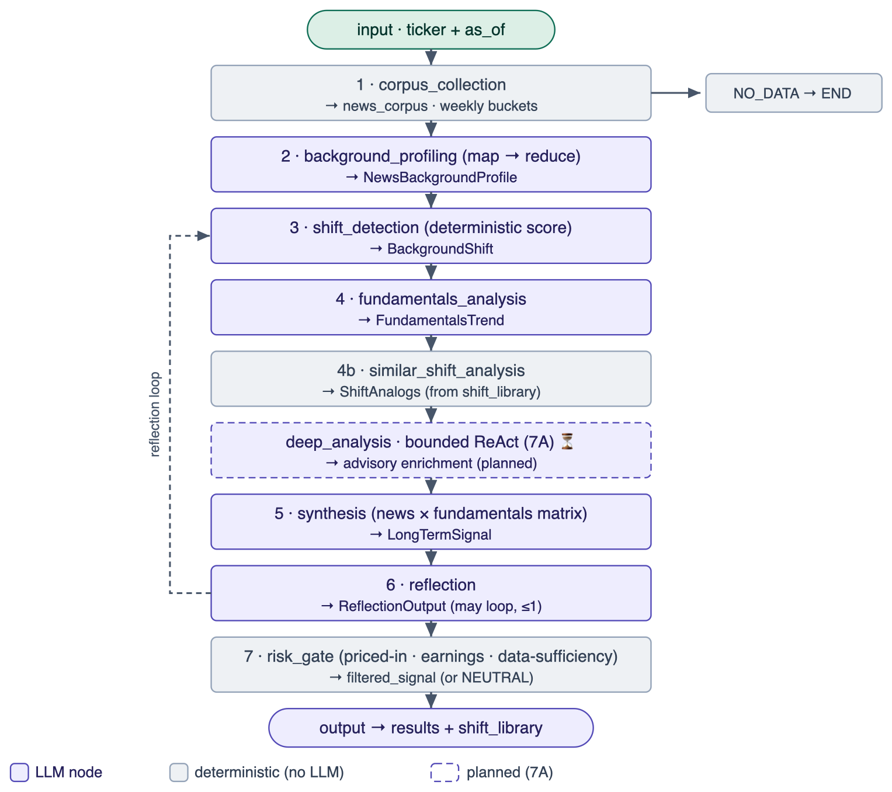
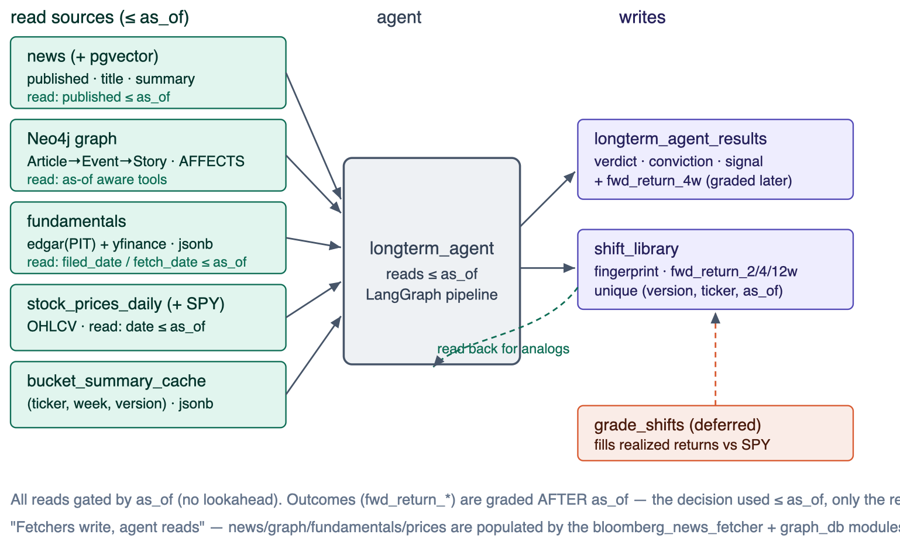
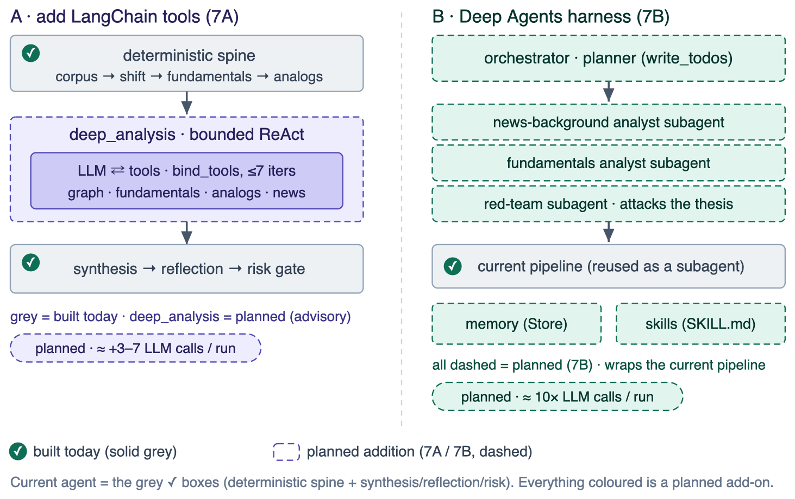

# Long-Term Trading Agent

A multi-week trading agent that analyzes a company's **whole news flow over a period**
(60–90 days), builds its **news background**, detects **shifts** in that background,
cross-checks against **point-in-time fundamentals**, and emits a risk-gated
LONG / SHORT / NEUTRAL signal with a thesis and invalidation conditions.

Companion to the intraday `news_agent` (one-headline → intraday signal). This one is
**company-driven**: input is a ticker + date, output is a weeks-to-months thesis.

- **Schemas** (state, Pydantic outputs, DB tables, pipeline): [SCHEMAS.md](SCHEMAS.md)
- **Deployment** (scheduler, Telegram alerts + stats bot, Docker): [DEPLOY.md](DEPLOY.md)
- **Design rationale & build history**: [../LONG_TERM_AGENT_PLAN.md](../LONG_TERM_AGENT_PLAN.md)
- **Advanced-analysis plan (7A)**: [DEEP_ANALYSIS_PLAN.md](DEEP_ANALYSIS_PLAN.md)
- **Architecture diagram**: [add_tools_vs_deep_agents.svg](add_tools_vs_deep_agents.svg)

---

## 1. How it works (pipeline)

`LangGraph` pipeline; input `ticker + as_of`, output a risk-gated signal. Full schema in
[SCHEMAS.md §1](SCHEMAS.md#1-pipeline-schema).



| # | Node | LLM? | What it does |
|---|---|---|---|
| 1 | `corpus_collection` | no | Builds the company corpus (Neo4j `AFFECTS` ∪ word-boundary regex), dedups by `news.id`, buckets by week. **< 8 articles → NO_DATA exit.** |
| 2 | `background_profiling` | yes (map-reduce) | Cheap model summarizes each weekly bucket (cached per `(ticker, week)`); main model merges → `NewsBackgroundProfile`. |
| 3 | `shift_detection` | quant + yes | Computes sentiment z-score, attention spike, narrative turnover, new-story emergence → **deterministic** `shift_score`/`has_shifted`; LLM only characterizes (catalysts, reasoning). |
| 4 | `fundamentals_analysis` | yes | Reads PIT fundamentals + valuation + analyst-estimate "expectation gap" + 180d technicals → verdict `confirms\|ignores\|contradicts`. |
| 4b | `similar_shift_analysis` | no | Queries `shift_library` for graded analogs (leakage + version filtered) → base rate. |
| — | `deep_analysis` | ⏳ planned | Bounded ReAct tool node (7A) — advisory only; see [DEEP_ANALYSIS_PLAN.md](DEEP_ANALYSIS_PLAN.md). |
| 5 | `synthesis` | yes | news×fundamentals matrix → `LongTermSignal` (direction, conviction, horizon, thesis, invalidation). |
| 6 | `reflection` | yes | Quality check; may loop back to shift/fundamentals (≤ `MAX_REFLECTION_ITERATIONS`). |
| 7 | `risk_gate` | no | Priced-in check, earnings-event risk, **data-sufficiency guard**, conviction threshold → `filtered_signal`. |

**The synthesis matrix** (the core logic):

| | Fundamentals improving | Fundamentals deteriorating |
|---|---|---|
| **News shift positive** | high-conviction LONG | hype risk — avoid |
| **News shift negative** | overreaction → contrarian LONG / NEUTRAL | high-conviction SHORT |

---

## 2. Data layer (fetchers write, agent reads)

All point-in-time. Tables in [SCHEMAS.md §4](SCHEMAS.md#4-database-schemas).



| Data | Source / fetcher | Read as-of by |
|---|---|---|
| News + embeddings | `bloomberg_news_fetcher/news_fetcher.py` → `news` | `published ≤ as_of` |
| Knowledge graph | `graph_db/` → Neo4j (`Article→Event→Story`) | event/article date |
| Daily prices (2y) + SPY | `bloomberg_news_fetcher/daily_price_fetcher.py` → `stock_prices_daily` | `date ≤ as_of` |
| Fundamentals (PIT) | `bloomberg_news_fetcher/edgar_fetcher.py` + `fundamentals_fetcher.py` → `fundamentals` | `filed_date / fetch_date ≤ as_of` |

- **EDGAR** (`edgar_fetcher.py`) — true point-in-time historical statements from the XBRL
  `companyfacts` feed; each statement keyed by its original filing date. Income / balance /
  cash-flow, ~7 years, with sector-specific revenue tags (incl. banks/energy).
- **yfinance** (`fundamentals_fetcher.py`) — current snapshots (valuation ratios, analyst
  estimates, earnings dates) keyed by `fetch_date`; builds a forward PIT archive.

---

## 3. Configuration (`config.py` → `LongTermAgentConfig`)

All via env (`.env`). Models come from the repo-root `model_config.py` (OpenRouter).

| Env var | Default | Meaning |
|---|---|---|
| `LT_LOOKBACK_DAYS` | 60 | background window (raise to 90 as news history accrues) |
| `LT_SHIFT_WINDOW_DAYS` | 14 | recent slice for shift detection |
| `LT_BUCKET_DAYS` | 7 | weekly buckets |
| `LT_MIN_ARTICLES` | 8 | NO_DATA threshold |
| `LT_SHIFT_Z` | 1.0 | sentiment z-score shift threshold |
| `LT_TECH_DAYS` | 180 | technicals lookback |
| `LT_EARNINGS_RISK_DAYS` | 10 | flag earnings within N days |
| `LT_CONF_THRESHOLD` | 0.55 | min conviction to pass the risk gate |
| `LT_MAX_REFLECTION` | 1 | reflection loops (0 for backtests) |
| `LT_AFFECTS_MIN_CONF` | 0.5 | Neo4j AFFECTS confidence floor |
| `LT_DEEP_ANALYSIS` | (7A) | enable the deep_analysis node (off in backtest) |
| `DB_HOST/NAME/USER/PASSWORD/PORT` | — | Postgres |
| `OPENROUTER_API_KEY` | — | LLM |
| `SEC_EDGAR_USER_AGENT` | — | required by SEC fair-access for the EDGAR fetcher |
| `LANGCHAIN_API_KEY` / `LANGCHAIN_PROJECT` | — / `longterm-trading-agent` | LangSmith tracing |

---

## 4. Running

```bash
# 0. one-time data backfills (in bloomberg_news_fetcher/)
SEC_EDGAR_USER_AGENT="Name you@email" python fundamentals_fetcher.py        # EDGAR + yfinance, all tickers
python daily_price_fetcher.py --period 2y                                    # daily bars (+ SPY)

# 1. run the agent for one ticker
python -m longterm_agent.run_longterm_agent --ticker NVDA --as-of 2026-06-15 --lookback 60
python -m longterm_agent.run_longterm_agent --ticker NVDA --as-of 2026-06-15 --trace   # + LangSmith

# 2. detection backtest: replay → grade → report
python -m longterm_agent.backfill_shift_library --tickers NVDA AAPL MSFT --start 2026-04-30 --end 2026-05-14
python -m longterm_agent.grade_shifts
python -m longterm_agent.backtest_report

# 3. full-signal backtest (whole pipeline → signal → graded vs SPY)
LT_MAX_REFLECTION=0 python -m longterm_agent.full_signal_backtest \
    --tickers NVDA AAPL MSFT TSLA AMD JPM AMZN META --start 2026-04-30 --end 2026-05-18
```

---

## 5. Determinism & no-lookahead (why it's trustworthy)

- **`as_of` gates everything.** Every query filters to data ≤ `as_of` (news `published`,
  EDGAR `filed_date`, yfinance `fetch_date`, prices `date`). The same code runs live
  (`as_of` = today) and in backtest (`as_of` = a past date) — no separate "backtest mode".
- **Deterministic decision spine.** `shift_score`/`has_shifted` and the risk gate are
  rule-based; the LLM only *characterizes*. So `shift_library` labels are reproducible and
  the bucket cache makes the map step reproducible too.
- **Outcome grading looks *after* `as_of`** (the +2/4/12w return) — allowed, because the
  *decision* used ≤ `as_of`; only the *outcome* is measured later.

---

## 6. Testing & observability

- **Tests** (`tests/`, run `pytest longterm_agent/tests/` — 35 passing): EDGAR normalization
  (PIT, restatement-ignore, dedup), corpus word-boundary regex + bucketing, the
  `_has_usable_fundamentals` guard, shift metrics (synthetic series), risk-gate guard,
  shift-library leakage/version filters, grade math, the retry/fallback helpers. Pure-logic
  tests need no DB; integration tests skip cleanly if the DB is unreachable.
- **LangSmith** — `--trace` (or `LongTermAgentConfig.enable_tracing()`) sends full LangGraph
  traces to project `longterm-trading-agent`. Note: tracing **exports prompts** (news,
  financials, model reasoning) to the LangSmith cloud.

---

## 7. Honest status

- ✅ Built & verified: the full pipeline, data layer, tests, tracing, and **Phase 6 ops** —
  weekly scheduler, Telegram alerts + read-only stats bot, Docker/compose ([DEPLOY.md](DEPLOY.md)).
- 🟡 Smoke-tested only: the detection backtest and full-signal backtest **ran** but the
  results are **n=17 single-regime noise** — they validate the *machinery and behavior*,
  not the *strategy*. A real verdict needs forward accumulation across regimes. The `/trades`
  win-rate only becomes meaningful after a quarter of graded forward cohorts.
- ⏳ Deferred: full-universe replay, conviction calibration, the `deep_analysis` tool node
  (7A), and the Deep Agents harness (7B).

Current build (grey ✓) vs the two planned advanced-analysis approaches:



---

## 8. File map

```
longterm_agent/
├── config.py                  LongTermAgentConfig (+ enable_tracing)
├── state.py                   LongTermAgentState (LangGraph state)
├── schemas.py                 Pydantic node outputs
├── company_names.py           ticker → news-name map (for the regex recall path)
├── agent/
│   ├── nodes.py               all 7+ nodes + helpers (_invoke_structured, _has_usable_fundamentals)
│   └── graph.py               LangGraph wiring + reflection loop
├── tools/
│   ├── news_corpus_tool.py    corpus retrieval (graph ∪ regex) + weekly bucketing
│   ├── background_metrics.py  quantitative shift metrics (z-score, spike, turnover, score)
│   ├── fundamentals_tool.py   PIT fundamentals reader + derived metrics
│   ├── technical_tool.py      daily technicals (MA50/200, trend)
│   ├── shift_library_tool.py  write / grade / find_similar_shifts
│   ├── risk_tool.py           priced-in + earnings-event checks
│   └── bucket_cache.py        per-week map-summary cache
├── run_longterm_agent.py      CLI (single ticker)
├── persistence.py             writes results + shift_library rows
├── backfill_shift_library.py  detection replay (populates shift_library)
├── grade_shifts.py            fills realized shift_library outcomes
├── grade_results.py           fills realized trade outcomes (4w vs SPY)
├── backtest_report.py         detection backtest report
├── full_signal_backtest.py    whole-pipeline backtest vs SPY
├── llm_cache.py               content-addressed LLM cache → reproducible/cheap backtests (B0)
├── ── Phase 6 ops ──
├── batch_run_longterm.py      weekly full-pipeline batch + new/flipped-signal alerts
├── auto_longterm_agent.py     scheduler (weekly batch + daily grading) — container entrypoint
├── notifier.py                Telegram push (alerts)
├── stats.py                   stats queries + win-rate math (CLI: python -m longterm_agent.stats)
├── stats_bot.py               read-only Telegram bot (/stats /signals /trades /errors /ticker)
├── oplog.py                   operational log writer (longterm_agent_log)
├── Dockerfile                 image for scheduler + bot
├── requirements.txt           ops deps
├── create_*.sql               shift_library / bucket_cache / results / oplog / llm_cache DDL
├── README.md / SCHEMAS.md / DEPLOY.md / DEEP_ANALYSIS_PLAN.md / BACKTEST_PLAN.md
└── tests/                     pytest suite (46)
```
Data fetchers live in `../bloomberg_news_fetcher/` (`edgar_fetcher.py`,
`fundamentals_fetcher.py`, `daily_price_fetcher.py`, and their `create_*.sql`).
Compose services `longterm-agent` (scheduler) + `longterm-stats-bot` are in the root
`docker-compose.yml`.
