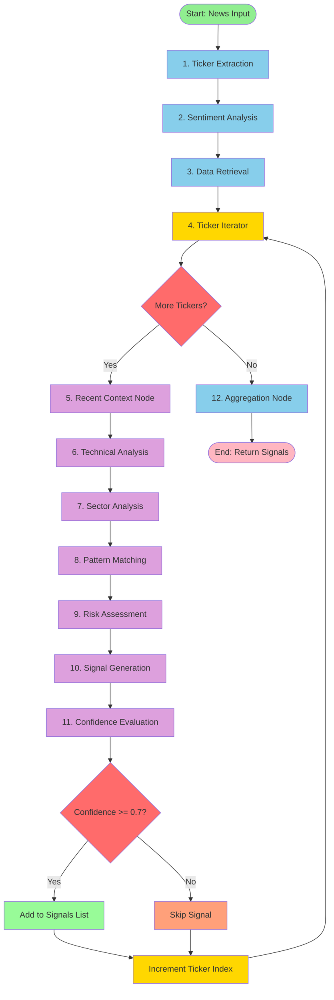

# Trading Agent - LangGraph Schema

## Visual Flow Diagram



## Detailed Node Flow

### Phase 1: Initial Analysis (All Tickers)
```
┌─────────────────────────────────────────────────────────────┐
│                     PHASE 1: SETUP                          │
├─────────────────────────────────────────────────────────────┤
│                                                             │
│  [1] Ticker Extraction Node                                 │
│      Input: news_text                                       │
│      Tool: ticker_extraction_tool                           │
│      Output: List of tickers (e.g., ["AAPL", "MSFT"])      │
│                                                             │
│                          ↓                                  │
│                                                             │
│  [2] Sentiment Analysis Node                                │
│      Input: news_text, tickers                              │
│      Tool: sentiment_analysis_tool                          │
│      Output: Sentiment per ticker                           │
│      {                                                      │
│        "AAPL": {sentiment: "bullish", intensity: 85},       │
│        "MSFT": {sentiment: "neutral", intensity: 45}        │
│      }                                                      │
│                                                             │
│                          ↓                                  │
│                                                             │
│  [3] Data Retrieval Node                                    │
│      Input: tickers, timestamp                              │
│      Tool: db_query_tool                                    │
│      Output: Historical prices per ticker (30 days)         │
│      Time-aware: WHERE date < timestamp                     │
│                                                             │
└─────────────────────────────────────────────────────────────┘
```

### Phase 2: Per-Ticker Analysis Loop
```
┌─────────────────────────────────────────────────────────────┐
│              PHASE 2: PER-TICKER ANALYSIS                   │
├─────────────────────────────────────────────────────────────┤
│                                                             │
│  [4] Ticker Iterator Node                                   │
│      Sets: current_ticker = tickers[index]                  │
│      Example: current_ticker = "AAPL"                       │
│                                                             │
│                          ↓                                  │
│                                                             │
│  ╔═════════════════════════════════════════════════════╗   │
│  ║        FOR EACH TICKER (Sequential Processing)      ║   │
│  ╚═════════════════════════════════════════════════════╝   │
│                                                             │
│  [5] Recent Context Node                                    │
│      Tool: get_recent_news                                  │
│      Checks: Recent news for this ticker (24h)              │
│      Output: List of recent news items                      │
│                                                             │
│                          ↓                                  │
│                                                             │
│  [6] Technical Analysis Node                                │
│      Tool: technical_analysis_tool                          │
│      Calculates:                                            │
│        - ATR (for stop-loss)                                │
│        - RSI, Moving Averages                               │
│        - Bollinger Bands                                    │
│        - Support/Resistance levels                          │
│      Output: Technical indicators dict                      │
│                                                             │
│                          ↓                                  │
│                                                             │
│  [7] Sector Analysis Node                                   │
│      Tool: sector_competitor_tool                           │
│      Analyzes:                                              │
│        - Ticker's sector                                    │
│        - Competitor performance                             │
│        - Sector-wide trends                                 │
│      Output: Sector analysis dict                           │
│                                                             │
│                          ↓                                  │
│                                                             │
│  [8] Pattern Matching Node                                  │
│      Tool: historical_pattern_tool                          │
│      Uses: Vector embeddings                                │
│      Finds: Similar past news (via DB similarity search)    │
│      Returns: Historical price impact of similar events     │
│      Time-aware: Only news >= 1h before current             │
│                                                             │
│                          ↓                                  │
│                                                             │
│  [9] Risk Assessment Node                                   │
│      Tool: risk_assessment_tool                             │
│             └─> Calls: volatility_volume_detector_tool      │
│      Analyzes:                                              │
│        - Volatility (past day vs 30-day avg)                │
│        - Volume spikes (2x+ average)                        │
│        - Market conditions                                  │
│        - News severity                                      │
│      Output: Risk score (0-100) + breakdown                 │
│      Flag: is_hot_stock (high vol + high volume)           │
│                                                             │
│                          ↓                                  │
│                                                             │
│  [10] Signal Generation Node                                │
│       Uses: LLM with ALL collected context                  │
│       Input: All above analysis results                     │
│       LLM generates:                                        │
│         - Signal: BUY/SELL/HOLD                             │
│         - Stop Loss: Based on ATR                           │
│         - Take Profit: Based on risk-reward ratio           │
│         - Reasoning: Detailed explanation                   │
│       Output: Signal dict for current ticker                │
│                                                             │
│                          ↓                                  │
│                                                             │
│  [11] Confidence Evaluation Node                            │
│       Calculates confidence (0-1) based on:                 │
│         • Sentiment intensity (25%)                         │
│         • Historical pattern match (25%)                    │
│         • Technical confirmation (25%)                      │
│         • Risk assessment (25%)                             │
│       Penalty: -30% if is_hot_stock                         │
│                                                             │
│                          ↓                                  │
│                                                             │
│       ┌─────────────────────────────────┐                  │
│       │  IF confidence >= 0.7           │                  │
│       │    → Add signal to list         │                  │
│       │  ELSE                            │                  │
│       │    → Skip signal                │                  │
│       └─────────────────────────────────┘                  │
│                                                             │
│                          ↓                                  │
│                                                             │
│       current_ticker_index += 1                             │
│       LOOP BACK to [4] for next ticker                      │
│                                                             │
└─────────────────────────────────────────────────────────────┘
```

### Phase 3: Finalization
```
┌─────────────────────────────────────────────────────────────┐
│                  PHASE 3: AGGREGATION                       │
├─────────────────────────────────────────────────────────────┤
│                                                             │
│  [12] Aggregation Node                                      │
│       Input: signals list (all tickers with conf >= 0.7)    │
│       Output: Final list of signals                         │
│       Format:                                               │
│       [                                                     │
│         {                                                   │
│           "ticker": "AAPL",                                 │
│           "signal": "BUY",                                  │
│           "stop_loss": 150.25,                              │
│           "take_profit": 165.50,                            │
│           "confidence": 0.85,                               │
│           "reasoning": "Strong positive sentiment..."       │
│         },                                                  │
│         { ... more signals ... }                            │
│       ]                                                     │
│                                                             │
│                          ↓                                  │
│                                                             │
│                    RETURN TO USER                           │
│                                                             │
└─────────────────────────────────────────────────────────────┘
```

## State Evolution Example

### Input
```python
{
    "news_text": "Apple announces M4 chip while Microsoft launches AI...",
    "timestamp": datetime(2024, 11, 5, 14, 30)
}
```

### After Node 1 (Ticker Extraction)
```python
{
    "news_text": "Apple announces M4 chip...",
    "timestamp": datetime(2024, 11, 5, 14, 30),
    "tickers": ["AAPL", "MSFT"],
    "current_ticker_index": 0
}
```

### After Node 2 (Sentiment)
```python
{
    ...,
    "sentiment": {
        "AAPL": {"sentiment": "bullish", "intensity": 85},
        "MSFT": {"sentiment": "bullish", "intensity": 70}
    }
}
```

### After Node 3 (Data Retrieval)
```python
{
    ...,
    "historical_prices": {
        "AAPL": DataFrame(30 days of OHLCV),
        "MSFT": DataFrame(30 days of OHLCV)
    }
}
```

### After Node 4 (Iterator - First Ticker)
```python
{
    ...,
    "current_ticker": "AAPL",
    "current_ticker_index": 0
}
```

### After Nodes 5-11 (Analysis for AAPL)
```python
{
    ...,
    "recent_news_context": {"AAPL": [...]},
    "technical_indicators": {"AAPL": {ATR: 2.5, RSI: 65, ...}},
    "sector_analysis": {"AAPL": {sector: "Technology", ...}},
    "historical_patterns": {"AAPL": [{similarity: 0.85, ...}]},
    "risk_assessment": {"AAPL": {risk_score: 35, ...}},
    "ticker_results": {
        "AAPL": {
            "signal": "BUY",
            "stop_loss": 150.25,
            "take_profit": 165.50,
            "confidence": 0.85,
            "reasoning": "..."
        }
    },
    "signals": [
        {
            "ticker": "AAPL",
            "signal": "BUY",
            "stop_loss": 150.25,
            "take_profit": 165.50,
            "confidence": 0.85,
            "reasoning": "..."
        }
    ]
}
```

### Loop continues for MSFT...

### Final Output
```python
[
    {
        "ticker": "AAPL",
        "signal": "BUY",
        "stop_loss": 150.25,
        "take_profit": 165.50,
        "confidence": 0.85,
        "reasoning": "Strong positive sentiment (85/100)..."
    },
    {
        "ticker": "MSFT",
        "signal": "BUY",
        "stop_loss": 380.00,
        "take_profit": 410.00,
        "confidence": 0.78,
        "reasoning": "Bullish sentiment (70/100)..."
    }
]
```

## Conditional Edges

### Decision Point 1: More Tickers?
```
Location: After ticker_iterator_node
Condition: current_ticker_index < len(tickers)
    ├─ True → Continue to recent_context_node
    └─ False → Go to aggregation_node
```

### Decision Point 2: Confidence Check
```
Location: After confidence_evaluation_node
Condition: confidence >= CONFIDENCE_THRESHOLD (0.7)
    ├─ True → Add signal to list
    └─ False → Skip signal (log reason)
Then: Increment ticker index and loop back
```

## Tool Usage Matrix

| Node | Tools Used | DB Queries | LLM Calls |
|------|-----------|------------|-----------|
| 1. Ticker Extraction | ticker_extraction_tool | - | ✓ |
| 2. Sentiment Analysis | sentiment_analysis_tool | - | ✓ |
| 3. Data Retrieval | db_query_tool | ✓ | - |
| 4. Ticker Iterator | - | - | - |
| 5. Recent Context | get_recent_news | ✓ | - |
| 6. Technical Analysis | technical_analysis_tool | - | - |
| 7. Sector Analysis | sector_competitor_tool | ✓ | - |
| 8. Pattern Matching | historical_pattern_tool | ✓ (vector) | - |
| 9. Risk Assessment | risk_assessment_tool → volatility_volume_detector_tool | ✓ | - |
| 10. Signal Generation | - | - | ✓ |
| 11. Confidence Evaluation | - | - | - |
| 12. Aggregation | - | - | - |

**Total per news article (2 tickers):**
- LLM calls: 3
- DB queries: ~10-12
- Vector searches: 2

## Time Complexity

- **Single ticker**: ~10-15 seconds
- **Two tickers**: ~20-30 seconds
- **Five tickers**: ~50-75 seconds

Bottlenecks:
1. LLM calls (sentiment, signal generation)
2. Vector similarity search
3. Technical indicator calculations

## Graph Configuration

```python
# From agent/graph.py

workflow = StateGraph(TradingAgentState)

# Add all nodes
workflow.add_node("ticker_extraction", ticker_extraction_node)
workflow.add_node("sentiment_analysis", sentiment_analysis_node)
workflow.add_node("data_retrieval", data_retrieval_node)
workflow.add_node("ticker_iterator", ticker_iterator_node)
workflow.add_node("recent_context", recent_context_node)
workflow.add_node("technical_analysis", technical_analysis_node)
workflow.add_node("sector_analysis", sector_analysis_node)
workflow.add_node("pattern_matching", pattern_matching_node)
workflow.add_node("risk_assessment", risk_assessment_node)
workflow.add_node("signal_generation", signal_generation_node)
workflow.add_node("confidence_evaluation", confidence_evaluation_node)
workflow.add_node("aggregation", aggregation_node)

# Entry point
workflow.set_entry_point("ticker_extraction")

# Linear edges
workflow.add_edge("ticker_extraction", "sentiment_analysis")
workflow.add_edge("sentiment_analysis", "data_retrieval")
workflow.add_edge("data_retrieval", "ticker_iterator")
workflow.add_edge("ticker_iterator", "recent_context")
workflow.add_edge("recent_context", "technical_analysis")
workflow.add_edge("technical_analysis", "sector_analysis")
workflow.add_edge("sector_analysis", "pattern_matching")
workflow.add_edge("pattern_matching", "risk_assessment")
workflow.add_edge("risk_assessment", "signal_generation")
workflow.add_edge("signal_generation", "confidence_evaluation")

# Conditional edges
workflow.add_conditional_edges(
    "confidence_evaluation",
    should_continue_processing,
    {
        "continue": "ticker_iterator",  # More tickers
        "end": "aggregation"            # All done
    }
)

workflow.add_edge("aggregation", END)
```

## Summary

- **12 nodes** total
- **2 conditional branches** (ticker iteration, confidence check)
- **10 tools** (some nodes use multiple tools)
- **Sequential processing** per ticker
- **Time-aware** at every DB query
- **LangSmith traced** at every step

