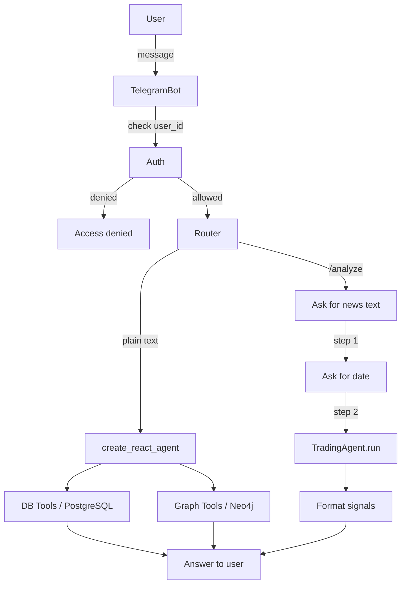

# Telegram Bot — Trading Agent

Q&A and news analysis bot powered by TradingAgent.

## Architecture



## Startup (Docker, run from project root)

> ⚠ **This image is the one that leaked.** The published
> `matveylebedev891/telegram-bot:latest` contained a real `/app/.env` and was public for
> four months — see [docs/SECURITY_INCIDENT_2026-08-11.md](../docs/SECURITY_INCIDENT_2026-08-11.md).
> There is no `docker push` step any more, and the image name is deliberately unqualified
> so there is nowhere to push it to. Verify `.dockerignore` excludes `.env` before building.

Locally:
```bash
# Build — unqualified name, date tag
docker build --platform linux/amd64 -t telegram-bot:$(date +%Y-%m-%d) -f telegram_bot/Dockerfile .

# Ship over SSH (refuses to send an image containing .env or *.bak)
DEPLOY_HOST=root@<SERVER_IP> deploy/ship_image.sh telegram-bot:$(date +%Y-%m-%d)
```

On the server — secrets come from the env file, never as `-e` literals:
```bash
TAG=2026-08-11
docker stop telegram-bot 2>/dev/null; docker rm telegram-bot 2>/dev/null
docker run -d \
    --name telegram-bot \
    --restart unless-stopped \
    --env-file /root/trade_agent/.env \
    -e TZ=America/New_York \
    --log-driver json-file --log-opt max-size=10m --log-opt max-file=3 \
    telegram-bot:$TAG
```

`TELEGRAM_ALLOWED_USER_IDS` lives in the env file too — it was previously inlined here,
which is how a copy-pasted run command drifts from the canonical file.

## Required `.env` variables

| Variable | Description |
|---|---|
| `TELEGRAM_BOT_TOKEN` | Token from [@BotFather](https://t.me/BotFather) |
| `TELEGRAM_ALLOWED_USER_IDS` | Comma-separated Telegram user IDs. Leave empty to allow all users. |
| `LANGCHAIN_API_KEY` | LangSmith API key. If set, tracing is enabled automatically. |
| `LANGCHAIN_PROJECT` | LangSmith project name (default: `telegram-bot`). |

## Bot commands

| Command | Description |
|---|---|
| `/start` | Welcome message |
| `/analyze` | Submit a news article for trade signal analysis |
| `/cancel` | Cancel current operation |
| `<any text>` | Ask a market question (Q&A mode) |
