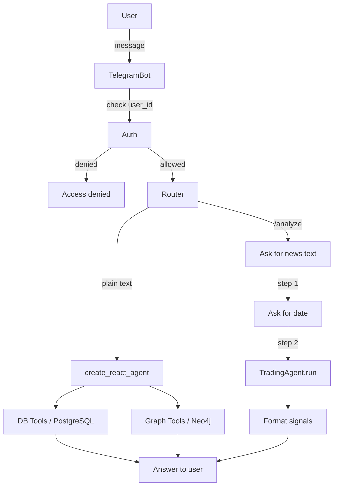

# Telegram Bot — Trading Agent

Q&A and news analysis bot powered by TradingAgent.

## Architecture



## Startup (Docker, run from project root)

```bash
# Build
docker build --platform linux/amd64 -t matveylebedev891/telegram-bot:latest -f telegram_bot/Dockerfile .

docker push matveylebedev891/telegram-bot:latest

docker stop telegram-bot 2>/dev/null; docker rm telegram-bot 2>/dev/null


# Run
docker run -d \
    --name telegram-bot \
    --restart unless-stopped \
    --env-file .env \
    -e TZ=America/New_York \
    -e TELEGRAM_ALLOWED_USER_IDS=YOUR_TELEGRAM_USER_ID,YOUR_TELEGRAM_USER_ID \
    -e OPENROUTER_API_KEY= \
    -e TELEGRAM_BOT_TOKEN= \
    -e LANGCHAIN_API_KEY= \
    matveylebedev891/telegram-bot:latest
```

## Required `.env` variables

| Variable | Description |
|---|---|
| `TELEGRAM_BOT_TOKEN` | Token from [@BotFather](https://t.me/BotFather) |
| `TELEGRAM_ALLOWED_USER_IDS` | Comma-separated Telegram user IDs. Leave empty to allow all users. |
| `LANGCHAIN_API_KEY` | LangSmith API key. If set, tracing is enabled automatically. |
| `LANGCHAIN_PROJECT` | LangSmith project name (default: `telegram-bot`). |

## Bot commands

| Command | Description |
|---|---|
| `/start` | Welcome message |
| `/analyze` | Submit a news article for trade signal analysis |
| `/cancel` | Cancel current operation |
| `<any text>` | Ask a market question (Q&A mode) |
